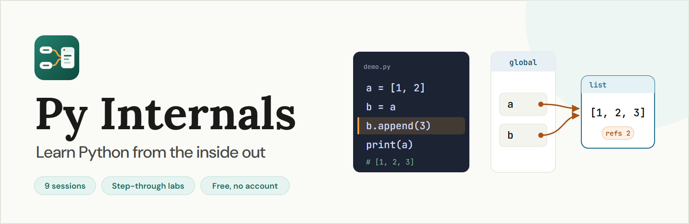
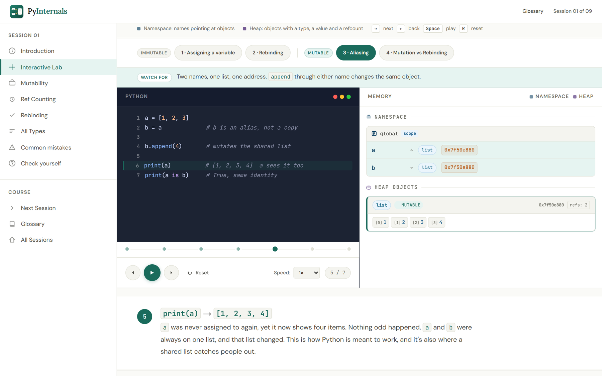
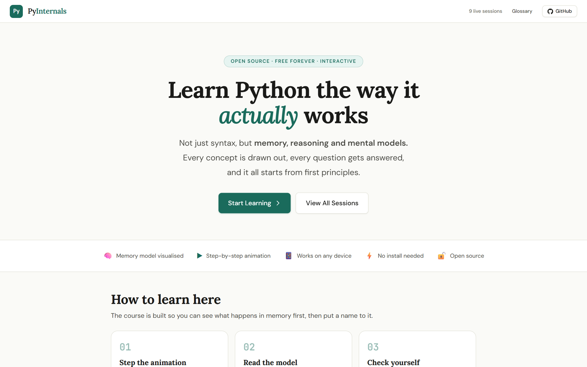
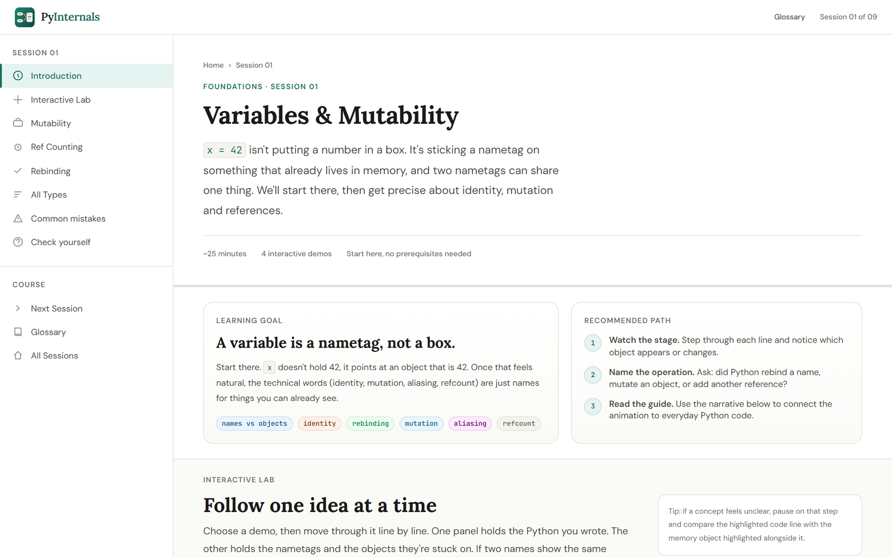
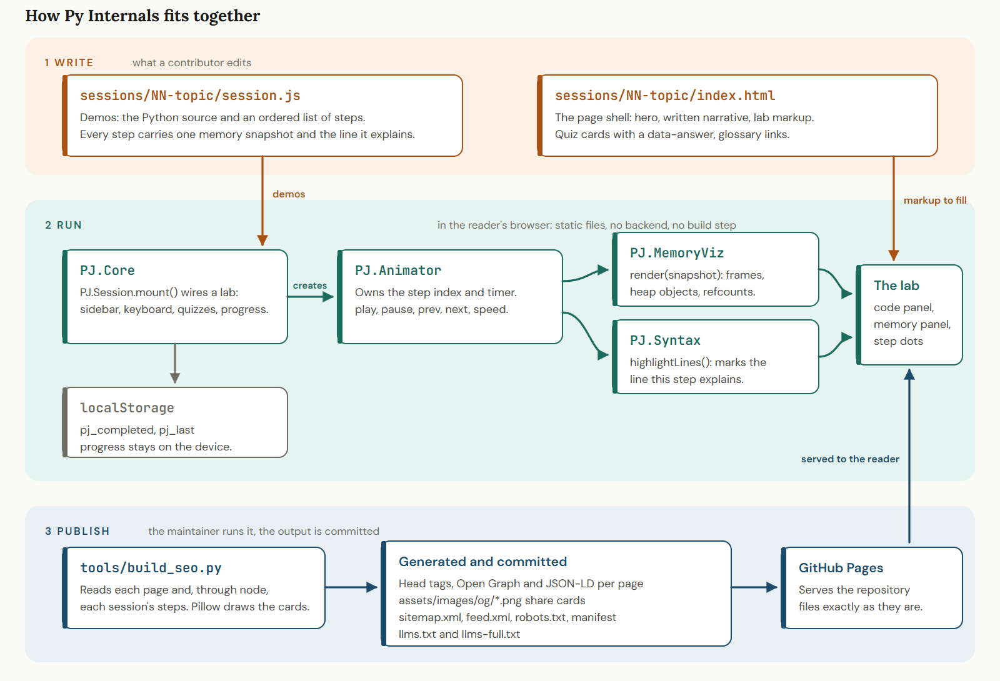

<p align="center">
  
</p>

# Py Internals

[](https://inboxpraveen.github.io/Py-Internals)
[](#course-content)
[](#license)
[](docs/ARCHITECTURE.md)
[](https://github.com/sponsors/inboxpraveen)

Py Internals is a free, open-source Python course that shows what your code does in memory. Every lesson is an animation you step through one line at a time: names pointing at objects, stack frames appearing and disappearing, reference counts going up and down, an exception climbing the call stack.

No account, no install, no analytics, and no requests to other sites. It is plain HTML, CSS and JavaScript, so it runs in any browser and you can read every line of it. The code is Apache-2.0 and the course content is CC BY-SA 4.0, so you can reuse both, with credit.

[**Start the course**](https://inboxpraveen.github.io/Py-Internals) · [Course content](#course-content) · [Use it in class](#use-it-in-your-class-or-on-your-site) · [How it works](#how-it-works) · [Run it locally](#run-it-locally) · [Contribute](#contributing) · [Sponsor](#support-the-project)

---

## What is this?

Most Python tutorials teach you *what* to type. Py Internals teaches you *what Python does with it.*

When you write `x = 42`, Python doesn't "store 42 in x". It makes an integer object, then binds the name `x` to it. When you write `b = a` on a list and then `b.append(3)`, nothing is copied, so `a` changes too. Both names point at one object:

```python
a = [1, 2]
b = a
b.append(3)
print(a)      # [1, 2, 3]
```

That gap, between using a tool and understanding it, is where bugs hide. It is why passing a list to a function sometimes changes the original and sometimes doesn't, and why your "optimisation" did nothing. The course closes that gap with a picture you can step through at your own pace.

<p align="center">
  
</p>

## What you get

- **Step-by-step labs.** Walk through a program one step at a time, or let it play. Keyboard: `→` and `←` to step, `Space` to play or pause, `R` to reset.
- **Real memory diagrams.** Stack frames, heap objects, reference counts and garbage collection, with every reference count checked against CPython.
- **Runtime state, too.** Session 07 draws the interpreter itself, so you can watch the GIL change hands. Session 08 draws a frame being torn down as an exception climbs the stack. Session 09 draws `sys.modules` filling up.
- **Quizzes that test the picture.** You predict the memory diagram, then see why.
- **A glossary** with plain-English definitions you can search in the middle of a lesson.
- **Written explanations** next to every lab, so each session also reads as an article.
- **Works on a phone.** The layout is checked down to 320 pixels wide.
- **Progress saved on your device.** Finished sessions are remembered in `localStorage`. Nothing is sent anywhere.

## Course content

| # | Session | Concepts |
|---|---------|----------|
| 01 | [Variables & Mutability](https://inboxpraveen.github.io/Py-Internals/sessions/01-variables/) | Names vs objects, rebinding, aliasing, mutation, garbage collection |
| 02 | [Functions & Scope](https://inboxpraveen.github.io/Py-Internals/sessions/02-functions/) | Call stack, frames, LEGB, closures, mutable defaults |
| 03 | [Lists, Dicts & References](https://inboxpraveen.github.io/Py-Internals/sessions/03-lists-dicts/) | Aliasing, shallow copy, deep copy, nested mutation |
| 04 | [Classes & Objects](https://inboxpraveen.github.io/Py-Internals/sessions/04-classes/) | `self`, `__init__`, `__dict__`, class vs instance, bound methods, MRO |
| 05 | [Iterators & Generators](https://inboxpraveen.github.io/Py-Internals/sessions/05-iterators/) | `iter` / `next`, `yield`, suspended frames, lazy vs eager |
| 06 | [Decorators](https://inboxpraveen.github.io/Py-Internals/sessions/06-decorators/) | `f = deco(f)`, wrappers, closure cells, `functools.wraps`, stacking |
| 07 | [The GIL & Concurrency](https://inboxpraveen.github.io/Py-Internals/sessions/07-gil/) | GIL, races, `Lock`, I/O vs CPU, `multiprocessing`, `asyncio`, free threading |
| 08 | [Exceptions, Tracebacks & Context Managers](https://inboxpraveen.github.io/Py-Internals/sessions/08-exceptions/) | `raise`, stack unwinding, tracebacks, `try` / `except` / `finally`, `with`, `raise from` |
| 09 | [Modules & Imports](https://inboxpraveen.github.io/Py-Internals/sessions/09-modules/) | `import`, module objects, `sys.modules`, `from ... import`, `__name__ == "__main__"`, circular imports, `sys.path` |

Sessions are released one at a time and build on each other, so start at 01 if you are new. Ideas for the next one are welcome in [Discussions](https://github.com/inboxpraveen/Py-Internals/discussions). There is also a [glossary](https://inboxpraveen.github.io/Py-Internals/glossary.html).

<p align="center">
  
</p>

<p align="center">
  
</p>

## Use it in your class or on your site

Py Internals is built to be shared.

- **Link straight to a session.** Each one stands on its own and has its own URL, so you can set one as pre-reading for a class or drop it into a bootcamp syllabus.
- **Host your own copy.** Fork the repository, turn on GitHub Pages for `main`, and you have the whole course on your own address. The same files work on Netlify, Vercel or any static host.
- **Translate or extend it.** The lessons are data, not code, so a new session or a new language is a new `session.js`, not a new engine. [IMPLEMENTATION_GUIDE.md](IMPLEMENTATION_GUIDE.md) shows how.
- **Use the pictures in talks and posts.** Screenshots and diagrams may be shared with credit and a link back here.
- **Read it as text.** [`llms-full.txt`](https://inboxpraveen.github.io/Py-Internals/llms-full.txt) is the whole course as Markdown, for language models and for anyone who wants the words without the animations.

The [licenses](#license) ask for credit and, for the course content, that changes are shared under the same terms. Commercial use is allowed under those terms.

## How it works

A session is not a video. It is a small Python program, authored as a sequence of memory snapshots. Each snapshot says which frames exist, which names are bound, which heap objects are alive and what their reference counts are. A shared engine turns a snapshot into the diagram, and an animator owns the clock.

<p align="center">
  
</p>

Because the content and the renderer are separate, a new lesson needs new data and not a new visualiser. [docs/ARCHITECTURE.md](docs/ARCHITECTURE.md) walks through each piece.

| Layer | Choice | Why |
|-------|--------|-----|
| Markup | Semantic HTML5 | Accessible, no framework needed |
| Styles | Vanilla CSS with custom properties | Zero runtime, one set of design tokens |
| Scripts | Plain `<script>` tags, no bundler | Trivial to read, fork and debug |
| Fonts | [Lora](https://fonts.google.com/specimen/Lora), [DM Sans](https://fonts.google.com/specimen/DM+Sans) and [JetBrains Mono](https://fonts.google.com/specimen/JetBrains+Mono), served from `assets/fonts/` | Editorial, readable, code-friendly, and no page calls another host |
| Hosting | GitHub Pages | Free, zero config, git-native |
| Progress | `localStorage` | No backend to run or secure |
| Findability | `tools/build_seo.py` | Head tags, JSON-LD, share cards, sitemap, feed and `llms.txt`, all committed |

## Design philosophy

**Show, don't just tell.** Every concept in this course has a picture. If you can't draw a memory diagram for it, the explanation isn't done yet.

**One thing per step.** Each animation step introduces one new idea. No step ever asks you to track two changes at once.

**Beautiful enough to take seriously.** The design is deliberate: warm cream backgrounds, editorial typography, restrained colour. Learning tools don't have to look like homework.

You can study the source and build on it under the [licenses below](#license). Keep the credit the licenses ask for. The implementation guide explains how to add a session.

## Run it locally

No build tools, no `npm install`:

```bash
git clone https://github.com/inboxpraveen/Py-Internals.git
cd Py-Internals
python -m http.server 8000      # or: npx serve .
```

Then open <http://localhost:8000>.

Opening the files straight from disk mostly works, but a local server keeps the browser cache and the `localStorage` origin behaving the way they will in production.

To check a change, run `node tools/check_sessions.js`. To regenerate the head tags, sitemap, feed and `llms` files after adding or retitling a page, run `python tools/build_seo.py` (it needs Python 3.10+, Pillow and node, see [CONTRIBUTING.md](CONTRIBUTING.md)).

## Project structure

```
Py-Internals/
├── index.html                 Course homepage and session grid
├── glossary.html              Searchable term list
├── 404.html                   Not-found page with every session linked
├── LICENSE, LICENSE-CONTENT.txt, NOTICE    Apache-2.0 for the code, CC BY-SA 4.0 for the content
├── IMPLEMENTATION_GUIDE.md    How to build a new session
├── CONTRIBUTING.md, SECURITY.md, CODE_OF_CONDUCT.md
│
├── docs/
│   └── ARCHITECTURE.md        How the engine, the sessions and the build tool fit together
│
├── assets/
│   ├── css/                   base, layout, components, memory-viz, animations, session
│   ├── js/                    core, animator, memory-viz, syntax  (the PJ namespace)
│   ├── fonts/                 Lora, DM Sans and JetBrains Mono (woff2) with their OFL license texts
│   └── images/                logo, banner, architecture diagram, screenshots, og/ share cards
│
├── sessions/
│   └── NN-topic/              index.html (the page) and session.js (the demos), nine so far
│
├── tools/
│   ├── check_sessions.js      Demo data checks
│   └── build_seo.py           Generates the metadata files below
│
└── sitemap.xml, feed.xml, robots.txt, manifest.webmanifest, llms.txt, llms-full.txt
```

## Contributing

Corrections and new sessions are both welcome. [CONTRIBUTING.md](CONTRIBUTING.md) covers the setup and the checks, and [IMPLEMENTATION_GUIDE.md](IMPLEMENTATION_GUIDE.md) covers how to write a session. Good first contributions:

- Fix a typo or an unclear explanation in a session
- Improve the layout of a component on a small screen
- Add a callout or a tip to a narrative section
- Propose a topic in [Discussions](https://github.com/inboxpraveen/Py-Internals/discussions)

Found a bug? [Open an issue](https://github.com/inboxpraveen/Py-Internals/issues/new/choose). Security problems go through [SECURITY.md](SECURITY.md), not a public issue.

## Support the project

Py Internals is free and stays free. Each session takes real time to write, because every claim is run through Python and every diagram is checked on a phone. If the course helped you or your students, you can [sponsor the work on GitHub](https://github.com/sponsors/inboxpraveen). Starring the repo and sharing a session link helps too.

## License

Copyright 2026 Praveen Kumar. Two licenses apply, so each part has the terms that suit it:

| What | License |
|------|---------|
| The code: `assets/js/`, `assets/css/`, `tools/`, and the site pages | [Apache License 2.0](LICENSE) |
| The course: the lessons in `sessions/`, `glossary.html`, the guides in `docs/` and `IMPLEMENTATION_GUIDE.md`, and everything in `assets/images/` | [CC BY-SA 4.0](LICENSE-CONTENT.txt) |

In short:

- Free to use, share and adapt, including in classrooms, workshops and bootcamps
- Free to embed visuals in blog posts, talks and notes
- Credit is required, with a link back to this repository
- Changes to the course content must be shared under the same license
- Commercial use is allowed under these terms

The [NOTICE](NOTICE) file carries the credit line, and the Apache license asks you to keep it when you redistribute the code. The bundled fonts keep their own terms, the SIL Open Font License 1.1, with the texts in `assets/fonts/`.
## Acknowledgements

Inspired by the work of:

- [Python Tutor](https://pythontutor.com/) by Philip Guo, the original Python visualiser
- [CPython Developer's Guide](https://devguide.python.org/), the source of truth
- [Fluent Python](https://www.oreilly.com/library/view/fluent-python-2nd/9781492056348/) by Luciano Ramalho, the book that made Python's object model click
